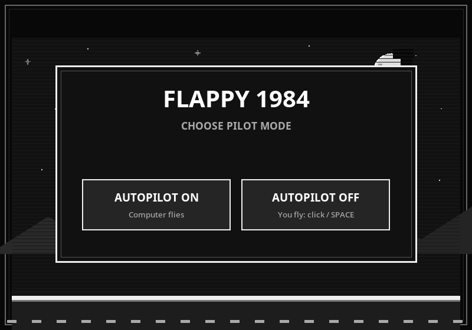

# Flappy Bird Autopilot


A retro pixel-art Flappy Bird game with an optional autopilot, built with Python and Tkinter.

## Play on Android

[Open the touch-friendly web game](https://tambet40.github.io/flappy-bird-autopilot/)

Open the link in Android Chrome. Choose **AUTOPILOT ON** to watch or **AUTOPILOT OFF** to fly by tapping the game screen.

## Start menu



## Download

### Download as a ZIP file

1. Open this repository's homepage.
2. Click **Code**, then select **Download ZIP**.
3. Extract the ZIP file.

### Clone with Git

Open a terminal or PowerShell and run:

```sh
git clone https://github.com/TAMBET40/flappy-bird-autopilot.git
cd flappy-bird-autopilot
```

## Run the game

On Linux:

```sh
python3 flappy_autopilot.py
```

On Windows PowerShell:

```powershell
py flappy_autopilot.py
```

Python 3 is required. The game uses Tkinter. If Tkinter is missing on Linux (for example, on Debian or Ubuntu), install it with:

```sh
sudo apt install python3-tk
```
